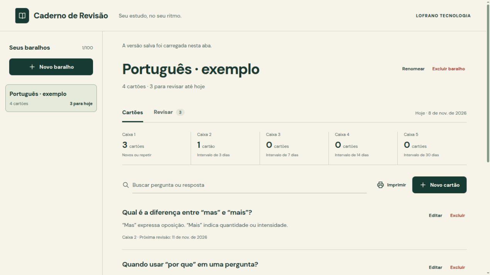

# Caderno de Revisão

Crie seus cartões de estudo e revise uma pergunta de cada vez, em português e sem cadastro. Uma ferramenta aberta da [LOFRANO TECNOLOGIA](https://lofranotecnologia.com.br).

**[Abrir o aplicativo](https://martinlofranodeoliveira.github.io/caderno-de-revisao/)** · [Formato do backup](docs/FORMATO.md) · [Algoritmo](docs/ALGORITMO.md)



*Exemplos demonstrativos carregados para a captura. A primeira abertura começa vazia.*

## O que você pode fazer

- Criar baralhos, escrever e editar perguntas e respostas, buscar e excluir cartões.
- Revisar os cartões vencidos: revelar a resposta e escolher **Lembrei** ou **Repetir**.
- Acompanhar a agenda por cinco caixas, com intervalos explícitos.
- Exportar e importar um backup JSON validado antes de substituir os dados.
- Imprimir as perguntas e respostas do baralho selecionado.
- Operar com teclado e carregar exemplos demonstrativos apenas se quiser.

A primeira abertura começa vazia. Clique em **Novo baralho**, dê um nome e crie seu primeiro cartão. Os exemplos opcionais podem ser editados ou excluídos.

## Seus dados

O conteúdo fica no armazenamento do navegador, sob a chave `lofrano.caderno.v1`. Não há conta, backend, telemetria, fonte remota ou integração de IA. Faça exportações regulares: limpar o navegador, trocar de perfil ou usar outro endereço pode deixar seus dados indisponíveis. O arquivo exportado contém seus textos; guarde-o com o cuidado adequado.

Se o armazenamento estiver bloqueado ou cheio, o aplicativo mantém a sessão na memória e avisa que você precisa exportar antes de sair. Dados locais inválidos não são apagados silenciosamente: você pode baixar o conteúdo original para recuperação ou confirmar a remoção apenas da chave deste aplicativo. Um backup importado substitui o caderno inteiro somente depois de validar e confirmar.

O funcionamento depois de carregar a página é local. Não há service worker: abrir ou atualizar a página inicialmente exige acesso ao site, a menos que você sirva o build localmente. Não é anunciado como PWA offline.

### Mais de uma aba

Navegadores com Web Locks permitem uma aba de edição por vez; as demais ficam somente para leitura. Depois de fechar a aba principal, use **Tentar assumir edição**. Alterações detectadas em outra aba não apagam o trabalho em memória: exporte sua cópia antes de carregar a versão salva. Sem Web Locks, a comparação antes de gravar é uma guarda otimista, não uma garantia de atomicidade entre processos. O aplicativo não é um editor colaborativo. Veja [armazenamento e recuperação](docs/ARMAZENAMENTO.md).

## Como a revisão funciona

Cartões novos começam vencidos hoje, na caixa 1. **Lembrei** avança uma caixa; **Repetir** volta à caixa 1. Os intervalos das caixas 1 a 5 são 1, 3, 7, 14 e 30 dias. Ao lembrar, o intervalo usado é o da nova caixa: da 1 para 2, por exemplo, a próxima revisão fica em 3 dias. A caixa 5 continua em 30 dias.

A agenda usa a data do seu calendário local na interface e aritmética Gregoriana independente de fuso no engine. O modo de estudo inclui somente os cartões vencidos. Editar a pergunta ou a resposta preserva a agenda. Este é um Leitner simples e transparente; não é FSRS, avaliação de conhecimento ou promessa de melhora da memória.

## Limites

Até 100 baralhos e 5.000 cartões, com títulos de até 80 e lados de até 2.000 caracteres Unicode, simultaneamente ao teto de **8 MiB de backup canônico UTF-8**. Os limites são conjuntos: não é possível combinar a quantidade máxima com textos máximos em todos os cartões se isso ultrapassar o orçamento. O aplicativo recusa a mudança sem cortar textos ou remover cartões. Todo estado válido pode ser exportado e reimportado dentro desse teto.

Perguntas e respostas são texto simples. HTML e Markdown permanecem literais. O importador rejeita campos extras, chaves duplicadas, datas inválidas e backups fora do formato; ele não executa código. Impressão depende da configuração e do navegador; confira a prévia antes de imprimir.

## Rodar localmente

Node.js 22.12+ e npm:

```sh
npm ci --ignore-scripts
npm run dev
```

Build estático e prévia:

```sh
npm run build
npm run preview
```

O pacote usa React/Vite, com versões e dependências fixadas no lockfile. Para verificar em Linux com `bubblewrap` e `util-linux` instalados:

```sh
python3 scripts/check-offline.py --node "$(command -v node)" --deps "$PWD/node_modules"
```

O checker prepara dependências previamente instaladas e executa testes/build com fonte e dependências somente leitura, sem rede, home ou credenciais. Não usa sudo no computador local. O CI usa sudo exclusivamente no runner efêmero do GitHub para entrar no mesmo namespace e instalar as ferramentas de isolamento.

## Testes e contribuição

```sh
npm test
```

Os testes públicos cobrem regras de dados, agenda, importação, armazenamento e fluxos DOM. Aceitação independente do engine foi congelada antes da implementação; os oráculos privados não fazem parte do repositório. Verificações de DOM não substituem validação visual e a11y integral. Consulte [CONTRIBUTING.md](CONTRIBUTING.md) para melhorias úteis.

## Licença

Código original sob [MIT](LICENSE), com [atribuições preservadas](THIRD_PARTY_NOTICES.md). DM Sans é servida localmente sob SIL OFL 1.1. A marca LOFRANO identifica a autoria; adapte sua marca ao distribuir uma edição própria.
